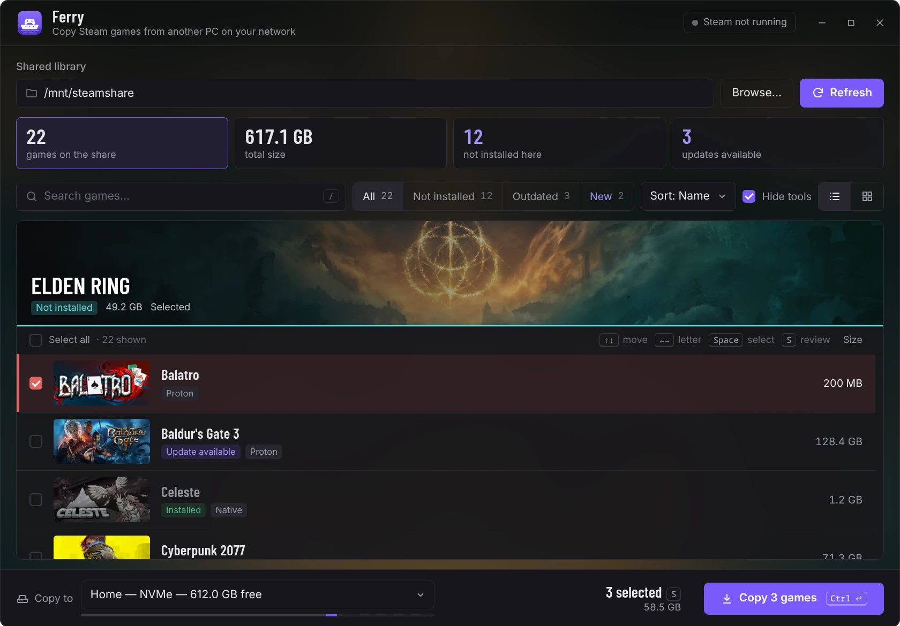
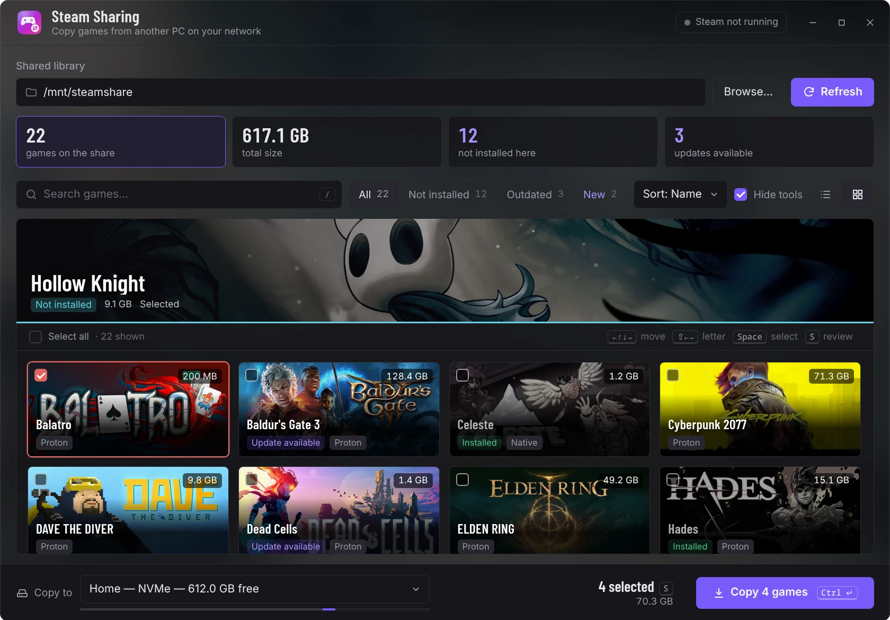
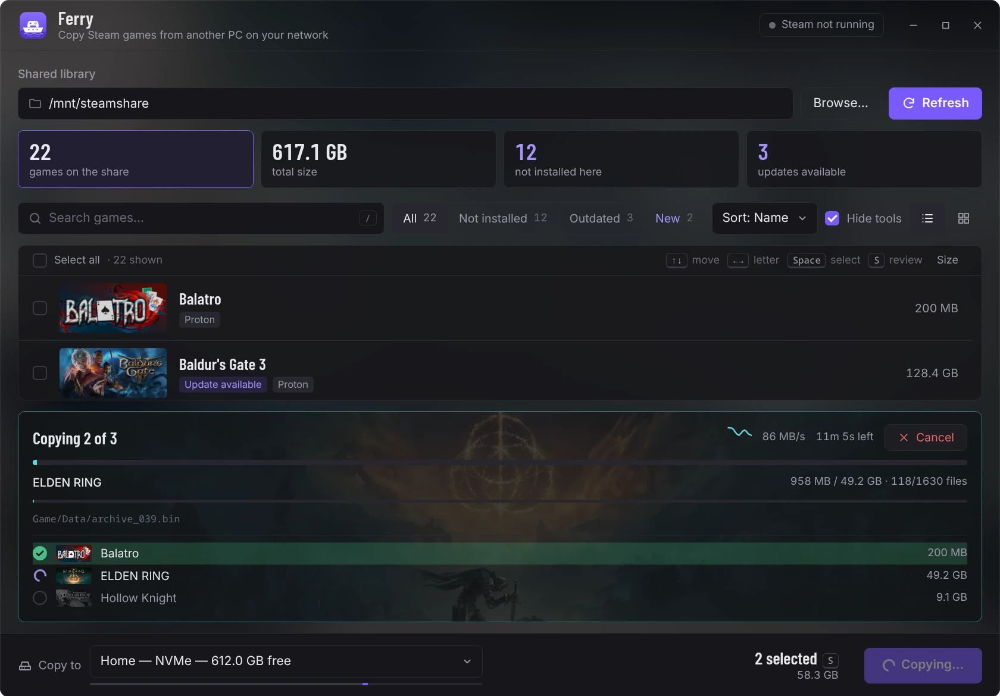

<p align="center">
  
</p>

<h1 align="center">Ferry</h1>

<p align="center">
  Ferry your Steam games across from another PC on your network, straight into your local Steam<br>
  library: uncompressed, over SMB, and much faster than Steam's own network transfer.
</p>

<p align="center">
  
  
  
  
  
</p>

<p align="center">
  
</p>

## Features

- **See what's on the other PC.** Every game on the share with its art, size and status:
  installed, update available, not installed, or new since your last visit.
- **Copy at full network speed.** Straight file copies over SMB, 4 files at a time, no
  compression, no Steam download queue.
- **Safe and resumable.** Steam never sees a half-copied game, interrupted copies pick up
  where they left off, and updates only copy what changed.
- **Live progress.** Speed graph, time left, a per-game queue, and progress on your taskbar.
- **Restart Steam in one click** when the copy finishes, so the new games show up straight away.
- **Delete local copies** of installed games from the app, e.g. to copy one again. Only the
  copy on the PC running Ferry is removed, never the share.
- **Tunable** parallel file copies in Settings, for games made of lots of small files.
- **Driven entirely from the keyboard** if you like (see below).
- **List or grid view,** filters for missing, outdated and new games, and a review of your
  selection before you copy.

<table>
  <tr>
    <td></td>
    <td></td>
  </tr>
  <tr>
    <td align="center"><sub>Grid view</sub></td>
    <td align="center"><sub>Copy in progress</sub></td>
  </tr>
</table>

<sub>Screenshots use a sample library.</sub>

## Getting started

1. **Share the Steam folder** on the PC that has the games (e.g. as an SMB share called
   `SteamShare`). The Steam root, a library root or the `steamapps` folder all work.
2. **Download Ferry** for the other PC from [Releases](../../releases/latest):
   - **Windows:** `.msi` or `-setup.exe`
   - **Linux:** `.AppImage` (any distro), `.deb` (Debian/Ubuntu) or `.rpm` (Fedora)
3. **Connect to the share:**
   - **Windows:** enter the network path, e.g. `\\MY-PC\SteamShare`
   - **Linux:** mount the share first (file manager, or `/etc/fstab` with `cifs`), then pick the
     mounted folder
4. **Pick games, copy, and restart Steam.** The games show up as installed.

> **Coming from Steam Sharing?** Ferry is the same app, renamed in v0.4.0. It installs as a
> separate app, so uninstall Steam Sharing afterwards. You'll need to pick your share again once.

## Keyboard shortcuts

| Key | Action |
|---|---|
| `↑` `↓` | Move through games (`←` `→` too in grid view) |
| `←` `→` | Jump to the next / previous letter (`Shift` + `←` `→` in grid view) |
| `Page Up` `Page Down` `Home` `End` | Jump a page / to the start or end |
| `Space` | Select or deselect the highlighted game |
| `/` | Search. Press `↓` or `Enter` to jump into the results |
| `S` | Review only the selected games |
| `Ctrl` + `A` | Select every game shown |
| `Ctrl` + `Enter` | Start copying |
| `Esc` | Clear the search, leave the review, or clear the selection |

## How it works

1. The app reads every `appmanifest_*.acf` on the share to list the games, their size, build and
   platform.
2. Selected games are copied into `steamapps/common/<installdir>` in the chosen local library,
   followed by their depot manifests and **the app manifest last**, so Steam never sees a
   half-copied game.
3. On its next start, Steam picks the games up as installed.

Details:

- Files are written as `*.sscopy-partial` and renamed when complete. Re-running a copy skips
  files whose size and modified time already match, so interrupted copies resume and updates
  are quick.
- There's a free-space check before each game.
- On Linux the executable bit is restored for ELF binaries and scripts (SMB often drops it).
- Native Linux builds are flagged when running on Windows, since they won't run there.
- When re-copying an updated game, files the update removed on the share are left in the local
  copy.
- Cover art comes from Steam's art cache on the share, falling back to the Steam CDN.

## Develop

```sh
npm install
npm run tauri dev
cd src-tauri && cargo test
```

Building needs Rust, Node.js and the [Tauri prerequisites](https://v2.tauri.app/start/prerequisites/)
for your OS. Windows also needs the WebView2 runtime (preinstalled on Windows 10/11) and the MSVC
build tools.

```sh
npm run tauri build
```

Build on each OS you want a binary for: Linux produces `.deb`, `.rpm` and AppImage; Windows
produces `.msi` and `.exe`.

> **Linux note:** WebKitGTK 2.54 has bugs with transparent windows, which the rounded window
> relies on. The app sets `WEBKIT_DISABLE_COMPOSITING_MODE=1` at startup and keeps a
> near-invisible moving layer (`.repaint`) so the whole window redraws. Both can be removed once
> WebKitGTK fixes transparent windows.

## Releases

GitHub Actions (`.github/workflows/release.yml`) builds the Linux and Windows installers and
publishes them as a release for the version in `src-tauri/tauri.conf.json`.

- **To publish a release,** bump `version` in `src-tauri/tauri.conf.json` (and `package.json` /
  `src-tauri/Cargo.toml` to match), add a section for it to [`CHANGELOG.md`](CHANGELOG.md), and
  merge to `main`.
- **Release notes** come from that version's `CHANGELOG.md` section. If there isn't one, they
  list the PRs merged since the last release instead.
- Merges that don't change the version don't build anything.
- **To rebuild the current release** (e.g. after a failed build), run the workflow manually from
  the Actions tab.
